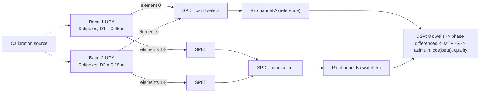

# Multi-Triangle Phase Interferometry for Two-Channel Azimuth Finding with a Dual-Band Nine-Element Dipole UCA (0.1–2.5 GHz)

**[Author names, affiliations]**

> **Draft status (v0.1).** Theory, algorithm and simulation study complete. Measured (anechoic/outdoor) results pending. All references must be verified (see Appendix C). Figures are produced by `python sim/run_experiments.py` (seed 2026).

## Abstract

Direction finding (DF) of emitters between 0.1 and 2.5 GHz is central to spectrum monitoring, interference hunting and electronic support. Hardware cost is dominated by the number of phase-coherent receiver channels. This paper presents an azimuth-finding system that uses only two coherent channels with a dual-band nine-element vertically polarized dipole uniform circular array (UCA). Diameters are 0.45 m for 0.1–0.8 GHz and 0.15 m for 0.8–2.5 GHz. One element serves as a fixed phase reference on channel A, while channel B is switched over the remaining eight elements. The eight elements form four reference-anchored isosceles triangles $T_k=\{0,k,9-k\}$ with chord ratios 1 : 1.88 : 2.53 : 2.88. We propose the multi-triangle phase interferometer (MTPI). Each triangle yields a closed-form azimuth estimate that is independent of frequency and source elevation. Phase ambiguities of the larger triangles are resolved in a nested coarse-to-fine order, with a multi-hypothesis seed and an SNR-adaptive admissibility guard. The eight unwrapped phases are fused by least squares, which reduces to a one-line closed form. A χ² residual test gates rare integer failures to a correlative-interferometer fallback (MTPI-G). We derive the Cramér–Rao bound (CRB) of the switched two-channel model and show that MTPI attains the elevation-unknown CRB. Its θ-averaged RMSE is $0.385\,\sigma_\Delta/\kappa$, within 0.6 dB of the elevation-known bound and 1.25 dB better than the normalized correlative interferometer. Monte Carlo results confirm the theory to within 2% at high SNR. MTPI-G matches the correlative interferometer's threshold at the top of the band while invoking the fallback for only 0.7–2% of DF cycles near threshold.

**Index Terms**: direction finding, angle of arrival, uniform circular array, phase interferometer, ambiguity resolution, correlative interferometer, Watson–Watt, two-channel receiver, spectrum monitoring.

---

## I. Introduction

Locating radio emitters by bearing is a core function of spectrum-monitoring and electronic-support systems [1], [5], [6]. The 0.1–2.5 GHz range contains VHF/UHF land-mobile and public-safety radio, broadcast TV, ISM bands at 433/868/915 MHz and 2.4 GHz, cellular bands, GNSS L-band and most unmanned-aircraft command links. A single DF system must therefore cover a 25:1 bandwidth.

Classical DF families trade aperture, channel count and computation against each other. Watson–Watt (WW) amplitude comparison with Adcock antennas [2], [3] is simple but needs three coherent channels and small apertures. Phase interferometers [4], [7], [8] achieve high accuracy with large baselines but must resolve $2\pi$ ambiguities. The correlative interferometer (CI) [1], [11] compares measured phase vectors with stored reference sets. It is robust and widely deployed, but it requires a search over azimuth (and elevation) plus per-frequency reference tables. Subspace methods such as MUSIC, ESPRIT and UCA-ESPRIT [12]–[15] resolve multiple emitters, but they need as many coherent channels as elements and careful calibration [21], [22].

This work targets a low-cost architecture: one two-channel coherent receiver, a nine-element UCA per band, and an RF switch. The contributions are as follows. First, a reference-anchored triangle decomposition of the nine-element UCA gives a closed-form, frequency- and elevation-invariant azimuth estimate per triangle and a closed-form fused estimate. Second, a nested ambiguity-resolution scheme exploits the four distinct triangle apertures, made robust by a multi-hypothesis seed, an SNR-adaptive guard and a χ² integrity gate with a correlative fallback. Third, a closed-form CRB analysis of the switched two-channel model is presented. It reveals a $\sqrt3$ azimuth anisotropy and quantifies MTPI against CI variants analytically. Fourth, an aperture-design rule for the two bands is given and validated by Monte Carlo simulation against Watson–Watt and two correlative-interferometer variants.

## II. Background and Related Work

**Amplitude comparison (Watson–Watt).** Orthogonal Adcock pairs and a sense antenna give $\theta=\operatorname{atan2}(V_{EW},V_{NS})$ [2], [3]. Spacing must remain well below λ/2, or octantal (spacing) errors grow. Three coherent channels are needed, or a commutated equivalent.

**Phase interferometry and ambiguity resolution.** A baseline $d$ yields $\Delta\phi=2\pi d\cos\psi/\lambda$, unambiguous only for $d<\lambda/2$. Accuracy scales as $\lambda/d$. Multi-baseline designs resolve ambiguities with baseline ratios, integer searches or the (robust) Chinese remainder theorem [7]–[10].

**Correlative interferometry.** The measured phase vector is correlated with reference vectors (computed or measured), and the maximum gives the bearing [1], [11]. CI tolerates array imperfections that are captured in the tables. Its cost is a grid search, table storage per frequency, and an additional elevation dimension for elevated sources.

**Subspace and sparse methods.** MUSIC [12], ESPRIT [13], UCA-ESPRIT/beamspace methods [14], sparse reconstruction [24] and learning-based estimators [25] provide super-resolution [15], [16], [23]. However, they need simultaneous multichannel data or long switched observations, and they are sensitive to coupling and calibration [21], [22].

**UCA design.** Phase-mode theory requires $M>2kR$ to avoid mode aliasing [17], [18]. A UCA with $M\ge3$ has azimuth-isotropic accuracy when all elements are sampled simultaneously [18]. Section VI shows this is *not* the case for the switched two-channel model.

**Table 1. Method comparison**

| Method | Coherent channels | Aperture | Ambiguity handling | Cost per estimate | Calibration |
|---|---|---|---|---|---|
| Watson–Watt / Adcock | 3 | small (spacing < λ/2) | not needed | very low | low |
| Single-baseline interferometer | 2 | ≤ λ/2 | not needed | very low | low |
| Multi-baseline interferometer | 2+ | large | integer search / CRT | low | medium |
| Correlative interferometer | 2+ (switched) | medium–large | global correlation search | medium–high | tables per frequency |
| MUSIC / ESPRIT / UCA-ESPRIT | M | ≤ aliasing limit | implicit | high | high |
| **MTPI-G (this work)** | **2 (switched)** | **D/λ ≤ 1.27** | **nested triangles + χ² gate** | **very low** (fallback only when flagged) | **per-element offsets** |

## III. System Architecture

### A. Dual-band antenna

Two coaxially stacked nine-element vertical-dipole UCAs are used: Band 1 (0.1–0.8 GHz) with $D_1=0.45$ m and Band 2 (0.8–2.5 GHz) with $D_2=0.15$ m. Element $m$ sits at $\gamma_m=2\pi m/9$ (40° spacing). Element 0 is the reference and defines θ = 0. An odd element count avoids diametrically opposite pairs and their front–back symmetry. Band-1 elements must be wideband (active or fat dipoles), since a passive half-wave dipole at 100 MHz is 1.5 m long. The element design is outside the scope of this paper.

### B. Two-channel receiver

Channel A is permanently connected to element 0 of the selected band. Channel B is switched by an SP8T over elements 1–8. In each of the eight dwells, $N$ complex samples are taken from both channels. A two-channel coherent tuner with a shared LO (e.g., an AD9361-class transceiver [26]) covers the full range. A calibration source injected at the element feeds measures the inter-channel phase offset after every retune, together with the per-path offsets.


*Fig. 2. Receiver architecture.*


*Fig. 1. Nine-element UCA with reference element 0 and the four triangles $T_k=\{0,k,9-k\}$.*

### C. Aperture design

Two constraints bound the diameter at the highest frequency of each band, $\lambda_{\min}$. Rule A requires the seed triangle $T_1$ (chord $\ell_1=D\sin 20^\circ$) to be unambiguous. Rule B is the phase-mode aliasing limit for M = 9.

```math
\text{(A)}\;\; \frac{D}{\lambda_{\min}} < \frac{1}{2\sin(\pi/M)} = 1.462, \qquad
\text{(B)}\;\; \frac{\pi D}{\lambda_{\min}} \le \frac{M-1}{2} \;\Rightarrow\; \frac{D}{\lambda_{\min}} \le 1.273 .
```

Accuracy at the lowest frequency improves with $D$, so $D$ is chosen close to the binding limit (B).

**Table 2. Aperture design**

| Band | f (GHz) | D (m) | D/λ range | T1 phase margin at f_max | Max wraps on T2–T4 |
|---|---|---|---|---|---|
| 1 | 0.1–0.8 | 0.45 | 0.150–1.201 | 32.1° | 1 |
| 2 | 0.8–2.5 | 0.15 | 0.400–1.251 | 26.0° | 1 |

Because all results depend on D/λ only (ideal array), Band 1 at 0.4 GHz and Band 2 at 1.2 GHz have the same D/λ = 0.60. Likewise, Band 1 at 0.8 GHz (1.20) and Band 2 at 2.5 GHz (1.25) nearly coincide.

## IV. Signal Model

Element positions are $\mathbf p_m=R[\cos\gamma_m,\ \sin\gamma_m]^T$, with $R=D/2$. For a plane wave from azimuth θ and elevation β, let $\mathbf u=\cos\beta[\cos\theta,\ \sin\theta]^T$ and $k_0=2\pi f/c$. With baselines $\mathbf b_m=\mathbf p_m-\mathbf p_0$, the noise-free phase difference of dwell $m$ is

```math
\Delta\phi_m = k_0\,\mathbf b_m^T\mathbf u = \kappa\left[\cos(\theta-\gamma_m)-\cos\theta\right],\qquad \kappa = k_0R\cos\beta,\quad m=1,\dots,8. \tag{1}
```

The receiver forms $\tilde{\Delta\phi}_m=\arg\sum_n x_B[n]x_A^*[n]=\mathcal W(\Delta\phi_m+n_m)$, where $\mathcal W$ wraps to $(-\pi,\pi]$. For an unknown Gaussian signal with per-sample SNR ρ, the noise terms $n_m$ are independent across dwells. Their variance equals the stochastic CRB of a two-sensor phase difference:

```math
\sigma_\Delta^2 = \frac{1+2\rho}{2N\rho^2}. \tag{2}
```

The baseline lengths are $\ell_m=|\mathbf b_m|=D\sin(\pi m/M)$, so $|\Delta\phi_m|\le k_0\ell_m$.

## V. Proposed Multi-Triangle Phase Interferometer

### A. Closed-form triangle estimator

For $T_k=\{0,k,M-k\}$, the two baselines are mirror images about the reference axis. Their sum and difference separate the two components of $\mathbf u$:

```math
S_k^{+}=\Delta\phi_k+\Delta\phi_{M-k}=-4\kappa\sin^2\!\frac{\pi k}{M}\cos\theta,\qquad
S_k^{-}=\Delta\phi_k-\Delta\phi_{M-k}=2\kappa\sin\frac{2\pi k}{M}\sin\theta . \tag{3}
```

```math
\hat\theta_k=\operatorname{atan2}\!\left(\tan\frac{\pi k}{M}\,S_k^{-},\;-S_k^{+}\right). \tag{4}
```

κ cancels in (4), so $\hat\theta_k$ is independent of frequency and elevation once the phases are unwrapped. Its θ-averaged high-SNR RMSE is

```math
\mathrm{RMSE}_k=\frac{\sigma_\Delta}{4\kappa\,\sin^2(\pi k/M)\cos(\pi k/M)}. \tag{5}
```

**Table 3. Triangle properties (M = 9, geometry only)**

| Triangle | Elements | Chord / D | Apex angle | RMSE factor (× σΔ/κ) | Ambiguity amplification $c^2$ nested / direct |
|---|---|---|---|---|---|
| T1 | {0,1,8} | 0.342 | 140° | 2.274 | seed |
| T2 | {0,2,7} | 0.643 | 100° | 0.790 | 7.41 / 7.41 |
| T3 | {0,3,6} | 0.866 | 60° (equilateral) | 0.667 | 1.80 / 21.5 |
| T4 | {0,4,5} | 0.985 | 20° | 1.484 | 0.66 / 34.5 |
| **Fused** | all 8 | – | – | **0.385** | – |

T1 is unambiguous but coarse, because its baselines are nearly parallel to the y-axis. T3 is the best-conditioned single triangle. T4 has the longest x-lever arm but a narrow apex. Fusion gains 4.8 dB over T3 and 15.4 dB over T1.

### B. Nested ambiguity resolution

Triangles are added in order of aperture. Let $\hat{\mathbf u}^{(s-1)}$ be the LS estimate from $T_1,\dots,T_{s-1}$. For each baseline of $T_s$:

```math
n_m=\arg\min_{n\in\mathcal N_m}\left|\tilde{\Delta\phi}_m+2\pi n-k_0\mathbf b_m^T\hat{\mathbf u}^{(s-1)}\right|,\quad
\mathcal N_m=\left\{n:\ |\tilde{\Delta\phi}_m+2\pi n|\le k_0\ell_m+g\right\}. \tag{6}
```

The admissible set $\mathcal N_m$ uses the physical bound to forbid spurious wraps at low frequency. The guard $g=\operatorname{clip}(3\hat\sigma_\Delta,\,0.5,\,\pi/2)$ adapts to the SNR, which is estimated from the measured coherence $\hat\gamma=\hat\rho/(1+\hat\rho)$. The prediction-error variance is $\sigma_\Delta^2 c_m^2$, with $c_m^2=\mathbf b_m^T(\sum_{\text{used}}\mathbf b\mathbf b^T)^{-1}\mathbf b_m$. Nesting keeps $c^2\le7.41$, whereas direct resolution from T1 reaches 34.5 (Table 3).

At $f_{\max}$, T1 has only a 26° margin to ±π, so noise can wrap the seed itself. MTPI therefore keeps both admissible branches of each T1 phase (at most four seeds), runs (6) for each seed, and keeps the seed with the smallest final LS residual.

### C. LS fusion and closed form

With $\mathbf A=k_0[\mathbf b_1,\dots,\mathbf b_8]^T$, the fused estimate is $\hat{\mathbf u}=(\mathbf A^T\mathbf A)^{-1}\mathbf A^T\boldsymbol{\Delta\phi}$. For the UCA, $\mathbf A^T\mathbf A=k_0^2R^2\,\mathrm{diag}(3M/2,\,M/2)$, so

```math
\hat\theta=\operatorname{atan2}\!\Big(3\sum_{m=1}^{8}\sin\gamma_m\,\Delta\phi_m,\;\sum_{m=1}^{8}(\cos\gamma_m-1)\,\Delta\phi_m\Big),\qquad \cos\hat\beta=\|\hat{\mathbf u}\|. \tag{7}
```

The magnitude gives an elevation estimate as a by-product. An optional variant, MTPI-δ, appends a column of ones to $\mathbf A$. This estimates a residual inter-channel offset δ jointly, at the price of a 4× larger variance of $\hat u_x$.

### D. Integrity gate (MTPI-G)

When all integers are correct, the residual statistic satisfies $r=\|\boldsymbol{\Delta\phi}-\mathbf A\hat{\mathbf u}\|^2/(\hat\sigma_\Delta^2+\sigma_{\text{cal}}^2)\sim\chi^2_{M-3}$. Cycles with $r>\chi^2_{6}(1-p_{fa})$, where $p_{fa}=10^{-3}$, are re-processed by the normalized correlative interferometer. Here $\sigma_{\text{cal}}$ is the residual calibration accuracy (1° in the simulations).

```text
Algorithm 1  MTPI-G (per DF cycle)
Input : wrapped phases dphi[1..8], coherence-based sigma_hat, frequency f
1  g <- clip(3*sigma_hat, 0.5, pi/2)
2  seeds <- admissible branch pairs of (dphi[1], dphi[8])          # <= 4
3  for each seed:
4      for k = 2..4: resolve dphi[k], dphi[9-k] by Eq. (6) using LS of T1..T(k-1)
5      u_hat <- LS of all 8 unwrapped phases; residual r
6  keep the seed with minimum r; theta <- Eq. (7); cos(beta) <- ||u_hat||
7  if r / (sigma_hat^2 + sigma_cal^2) > chi2_6(1 - p_fa): theta <- CI-N(dphi)
Output: theta, cos(beta), quality flag
```

**Complexity.** The fast path costs a few hundred real flops per cycle (at most four seeds × three 2-parameter LS updates, then one 8×2 projection), and no tables are needed. CI on a 1° grid needs 360 × 8 complex MACs plus refinement, and a reference table per frequency. MTPI-G's average cost is therefore the MTPI cost plus the fallback rate times the CI cost. Measured runtimes are in `results/summary.md`.

## VI. Performance Bounds

Each dwell's data depend on θ only through $\Delta\phi_m$, and the noise is independent across dwells. For a UCA with odd $M$, this gives

```math
\mathrm{CRB}(\theta\,|\,\beta)=\frac{\sigma_\Delta^2}{\kappa^2}\,\frac{2}{M\,(1+2\sin^2\theta)},\qquad
\mathrm{CRB}(\theta)=\frac{\sigma_\Delta^2}{\kappa^2}\,\frac{2}{M}\Big(\cos^2\theta+\frac{\sin^2\theta}{3}\Big), \tag{8}
```

The first bound assumes known elevation; the second treats β as unknown, and MTPI (7) attains it. Accuracy is therefore anisotropic, with a factor $\sqrt3$ between θ = 0° and 90°. It is worst when the source lies on the reference axis, a property of the fixed-reference switched architecture that does not appear in simultaneously sampled UCAs. The high-SNR variance of the normalized CI (CI-N), which fits a free common phase, is

```math
\mathrm{var}_{\text{CI-N}}(\theta)=\frac{\sigma_\Delta^2}{\kappa^2}\,\frac{2}{M}\Big(\cos^2\theta+\big(1-\tfrac{2}{M}\big)\sin^2\theta\Big). \tag{9}
```

Averaged over θ, the RMSE is $0.358$ (CRB with known β), $0.385$ (MTPI) and $0.444$ (CI-N), in units of $\sigma_\Delta/\kappa$. MTPI is therefore within 0.62 dB of the known-elevation bound without needing elevation, and 1.25 dB better than CI-N. The real-part CI (CI-R) attains $\mathrm{CRB}(\theta|\beta)$ but uses β in its reference vectors. A small-phase analysis shows a bias of about 4.4° at θ = 45° for a source at β = 30° when β = 0 is assumed.

## VII. Simulation Study

**Setup.** M = 9, N = 64 samples per dwell, unknown complex-Gaussian signal, independent AWGN, θ ~ U[0°, 360°), β = 0 unless stated, ideal array. CI-N/CI-R use a 1° grid with 0.05° and 0.002° refinement and β = 0 reference vectors. WW-PM synthesizes Watson–Watt from the zero- and first-order phase modes of the UCA [18], with known-frequency sign correction.

**Exactness.** With noise-free data at all four band edges, including one wrap on T2–T4, and at β = 40°, MTPI recovers θ to within $10^{-13}$ degrees and $\cos\beta$ exactly.

**High-SNR validation (ρ = 20 dB, 4000 trials, Band 2).**

| f | D/λ | MTPI | CRB (β unknown) | CI-R | CRB (β known) | CI-N | Eq. (9) | WW-PM |
|---|---|---|---|---|---|---|---|---|
| 1.2 GHz | 0.60 | 0.146° | 0.147° | 0.136° | 0.136° | 0.170° | 0.169° | 0.89° |
| 2.5 GHz | 1.25 | 0.072° | 0.070° | 0.067° | 0.065° | 0.082° | 0.081° | 7.0° |

All three interferometric estimators match their predicted variances to within about 2%. WW-PM is aliasing-limited, and it breaks down near the zeros of $J_0$ (D/λ ≈ 0.77) and $J_1$ (D/λ ≈ 1.22). It is therefore unsuitable for the upper part of each band at these apertures.

**Threshold region (2.5 GHz, D/λ = 1.25, 20 000 trials; probability of |e| > 10°).**

| ρ (dB) | MTPI core | MTPI-G | CI-N | CI-R | MTPI-G fallback rate |
|---|---|---|---|---|---|
| −6 | 5.6e-2 | 4.3e-3 | 4.4e-3 | 1.4e-3 | 9.6% |
| −5 | 2.1e-2 | 5e-4 | 5e-4 | 3e-4 | 4.3% |
| −4 | 7.0e-3 | < 5e-5 | 1e-4 | < 5e-5 | 2.0% |
| −2 | 2.1e-3 | < 5e-5 | < 5e-5 | < 5e-5 | 0.7% |

The χ² gate flagged 99–100% of the cycles with a wrong integer. MTPI-G therefore reproduces the CI threshold, while the expensive search runs on only a few percent of cycles near threshold and about $p_{fa}$ of cycles at high SNR. At 1.2 GHz the core MTPI threshold already matches CI-N; for example, at −4 dB the gross-error rates are 0.019 for MTPI, 0.013 for MTPI-G, 0.022 for CI-N and 0.008 for CI-R.

**Ablation (2.5 GHz, 5000 trials).** At −5 dB, a single seed with a fixed guard gives 0.114. The multi-hypothesis seed with the adaptive guard reduces this to 0.021, and the gate reduces it further to 5e-4. Direct T1→all resolution gives 0.135, which confirms the nesting order of Table 3.

Figs. 3–9 (`figures/`) show single triangles versus fusion, RMSE versus SNR at the four band edges, RMSE across 0.1–2.5 GHz, the azimuth anisotropy (8), threshold behaviour, robustness to element and inter-channel phase errors, and elevation. The full numerical tables are in `results/summary.md`.

## VIII. Practical Considerations

- **Calibration.** The inter-channel offset δ biases $\hat u_x$, while $S_k^-$ is immune to it. Calibrate δ after every retune, or use MTPI-δ.
- **Mutual coupling and mast scattering.** These are azimuth-dependent, so per-element offsets correct them only to first order. A measured manifold can feed the CI fallback, or a local CI refinement seeded by MTPI.
- **Switched sampling.** The emitter must remain on air for all eight dwells, i.e., $8(T_{\text{dwell}}+T_{\text{switch}})$. Short bursts and frequency hoppers need dwell-aware scheduling.
- **Single-source assumption.** Co-channel signals and multipath inflate the residual. The gate statistic doubles as a quality indicator for rejecting such bearings.
- **Polarization.** Vertical dipoles degrade on cross-polarized signals, so this effect must be quantified in measurements.

## IX. Conclusion

A two-channel, dual-band nine-element UCA with the proposed MTPI-G attains the elevation-unknown CRB in closed form. It matches the correlative interferometer's threshold while invoking its search only for flagged cycles, and it provides elevation as a by-product. Next steps are anechoic-chamber and outdoor validation following ITU-R test procedures [27], coupling-aware calibration, and extension to multiple emitters.

## References

[1] ITU-R, *Handbook on Spectrum Monitoring*, 2011 ed. Geneva: ITU, 2011.
[2] R. A. Watson-Watt and J. F. Herd, "An instantaneous direct-reading radiogoniometer," *J. IEE*, vol. 64, no. 353, pp. 611–622, 1926.
[3] P. J. D. Gething, *Radio Direction Finding and Superresolution*, 2nd ed. London: Peter Peregrinus, 1991.
[4] S. E. Lipsky, *Microwave Passive Direction Finding*. New York: Wiley, 1987.
[5] R. A. Poisel, *Electronic Warfare Target Location Methods*, 2nd ed. Norwood, MA: Artech House, 2012.
[6] D. Adamy, *EW 101: A First Course in Electronic Warfare*. Norwood, MA: Artech House, 2001.
[7] E. Jacobs and E. W. Ralston, "Ambiguity resolution in interferometry," *IEEE Trans. Aerosp. Electron. Syst.*, vol. AES-17, no. 6, pp. 766–780, Nov. 1981.
[8] Y.-W. Wu, S. Rhodes, and E. H. Satorius, "Direction of arrival estimation via extended phase interferometry," *IEEE Trans. Aerosp. Electron. Syst.*, vol. 31, no. 1, pp. 375–381, Jan. 1995.
[9] X.-G. Xia and G. Wang, "Phase unwrapping and a robust Chinese remainder theorem," *IEEE Signal Process. Lett.*, vol. 14, no. 4, pp. 247–250, Apr. 2007.
[10] X. Li, H. Liang, and X.-G. Xia, "A robust Chinese remainder theorem with its applications in frequency estimation from undersampled waveforms," *IEEE Trans. Signal Process.*, vol. 57, no. 11, pp. 4314–4322, Nov. 2009.
[11] Rohde & Schwarz, "Introduction into theory of direction finding," Radiomonitoring & Radiolocation catalog, Munich.
[12] R. O. Schmidt, "Multiple emitter location and signal parameter estimation," *IEEE Trans. Antennas Propag.*, vol. 34, no. 3, pp. 276–280, Mar. 1986.
[13] R. Roy and T. Kailath, "ESPRIT—Estimation of signal parameters via rotational invariance techniques," *IEEE Trans. Acoust., Speech, Signal Process.*, vol. 37, no. 7, pp. 984–995, Jul. 1989.
[14] C. P. Mathews and M. D. Zoltowski, "Eigenstructure techniques for 2-D angle estimation with uniform circular arrays," *IEEE Trans. Signal Process.*, vol. 42, no. 9, pp. 2395–2407, Sep. 1994.
[15] H. Krim and M. Viberg, "Two decades of array signal processing research: The parametric approach," *IEEE Signal Process. Mag.*, vol. 13, no. 4, pp. 67–94, Jul. 1996.
[16] L. C. Godara, "Application of antenna arrays to mobile communications, Part II: Beam-forming and direction-of-arrival considerations," *Proc. IEEE*, vol. 85, no. 8, pp. 1195–1245, Aug. 1997.
[17] P. Ioannides and C. A. Balanis, "Uniform circular arrays for smart antennas," *IEEE Antennas Propag. Mag.*, vol. 47, no. 4, pp. 192–206, Aug. 2005.
[18] D. E. N. Davies, "Circular arrays," in *The Handbook of Antenna Design*, vol. 2, A. W. Rudge et al., Eds. London: Peter Peregrinus, 1983, ch. 12.
[19] P. Stoica and A. Nehorai, "MUSIC, maximum likelihood, and Cramér–Rao bound," *IEEE Trans. Acoust., Speech, Signal Process.*, vol. 37, no. 5, pp. 720–741, May 1989.
[20] H. L. Van Trees, *Optimum Array Processing*. New York: Wiley, 2002.
[21] B. Friedlander and A. J. Weiss, "Direction finding in the presence of mutual coupling," *IEEE Trans. Antennas Propag.*, vol. 39, no. 3, pp. 273–284, Mar. 1991.
[22] A. J. Weiss and B. Friedlander, "Eigenstructure methods for direction finding with sensor gain and phase uncertainties," *Circuits Syst. Signal Process.*, vol. 9, no. 3, pp. 271–300, 1990.
[23] T. E. Tuncer and B. Friedlander, Eds., *Classical and Modern Direction-of-Arrival Estimation*. Academic Press, 2009.
[24] D. Malioutov, M. Çetin, and A. S. Willsky, "A sparse signal reconstruction perspective for source localization with sensor arrays," *IEEE Trans. Signal Process.*, vol. 53, no. 8, pp. 3010–3022, Aug. 2005.
[25] Z.-M. Liu, C. Zhang, and P. S. Yu, "Direction-of-arrival estimation based on deep neural networks with robustness to array imperfections," *IEEE Trans. Antennas Propag.*, vol. 66, no. 12, pp. 7315–7327, Dec. 2018.
[26] Analog Devices, "AD9361 RF Agile Transceiver," data sheet.
[27] ITU-R, Recommendation SM.2060, "Test procedure for measuring direction finder accuracy."

## Appendix A. Reproducing the results

```bash
pip install numpy scipy matplotlib
python sim/run_experiments.py          # about 3 min on one core; writes figures/ and results/
python sim/run_experiments.py --quick  # smoke test
```

## Appendix B. Repository layout

```text
README.md              this paper
sim/mtpi.py            geometry, measurement model, MTPI / MTPI-G, CI-N, CI-R, WW-PM, CRBs
sim/run_experiments.py Monte Carlo study -> figures/*.png, results/results.json, results/summary.md
```

## Appendix C. Notes for authors

1. Verify every reference above. They were written from memory without database access.
2. Add 2022–2026 SCI work. Suggested searches: "uniform circular array interferometer ambiguity", "correlative interferometer direction finding", "two-channel direction finding switched array", "UAV signal direction finding UCA", "deep learning DOA UCA". Suggested venues: IEEE TAES, TAP, TSP, AWPL, Sensors Journal, Access; IET Radar Sonar Navig.; IEEE SP / AP / AES Magazines.
3. Replace D1/D2 with your built diameters, and add measured results (chamber and outdoor).